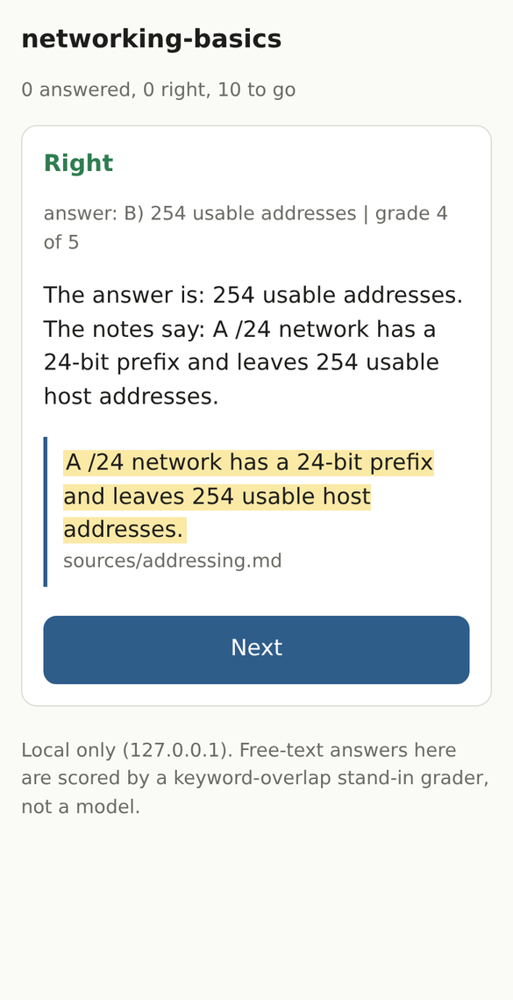
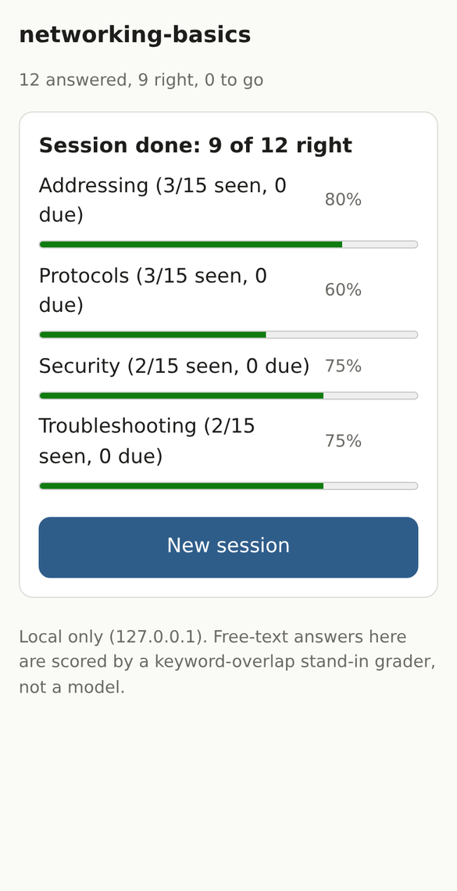
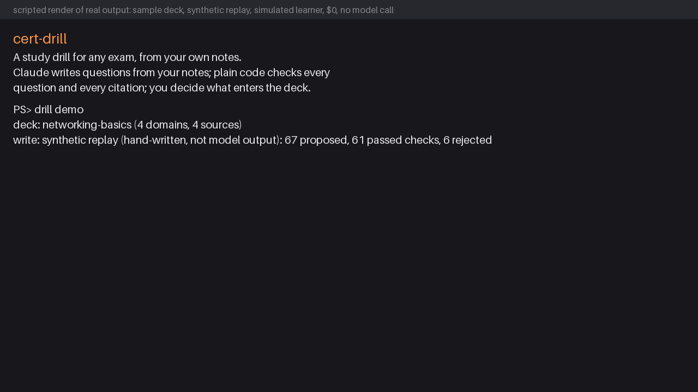

# cert-drill

A study drill for any exam, from your own notes. It is designed for Claude to write the questions from a source you supply and to grade free-text answers; this repository ships hand-written replays only, with no live model output yet. Plain code checks every question, every citation and the schedule; you decide what enters the deck.

`drill` reads a deck (exam domains with weights, plus note files you supply), proposes multiple-choice and short free-text questions with **citations that quote your notes**, refuses anything that breaks a checkable rule, and runs spaced-repetition sessions weighted to your weakest domain. Standard library only at run time. No network, no telemetry, no key, $0.

Example client: *Brightwater Adult Learning* (fictional community college). Brief: [docs/brief.md](docs/brief.md).

 

*The study page served by `drill serve --demo` from the sample deck, at phone width. Left: a question and its cited quote. Right: accuracy per domain after a session.*

## The problem

Learners who drill for a certification either write thousands of questions by hand or paste exam-dump content they should not have. A model can write questions from your own notes, but it can also write a wrong key, a quote that is not in the notes, or a question with two right answers, and a learner cannot tell without re-reading everything.

## The approach

```
your notes (deck.toml + sources/)
      |
      v   drill write: a model proposes questions, each with a quote from the notes
checker (code): schema, 4 distinct options, one key, no "all of the above",
      |         the quote is found in the named source, near-duplicate stems refused
      v   rejected.jsonl keeps every refusal with its reason
blind pass: the model answers WITHOUT the key; a disagreement is flagged to you
      |
      v   drill review: you approve or reject
questions.jsonl (approved)  ->  drill study / drill serve
      |   SM-2 schedule, weakest domains first
      v   free text: grader returns met / partly / missed + a quote per marking point;
          code keeps a point only if the quote is in your answer; code computes the score
```

- **Deck.** `decks/<name>/deck.toml` (name, domains and weights, source files, a `source_license` per file: `self-written`, `public-domain`, `cc-by` or `own-notes-private`), `questions.jsonl`, `pending.jsonl`, `rejected.jsonl` and a local `progress.sqlite`. Your own decks go in `decks/private/` (git-ignored).
- **Question checker (code).** Length caps, a domain that exists, four distinct options with exactly one key, no "all / none of the above", a batch check that the key is not usually the longest option, every citation names a deck source and its quote is found there (whitespace and quote marks normalised), near-duplicate stems refused, free-text questions carry 2 to 5 cited marking points.
- **Blind pass.** "More than one right answer" cannot be found by code. The model answers each question without the key; a disagreement reaches you as "check this key". Best effort.
- **Scheduler (code).** SM-2 per question with an injected clock. A session is the due questions, then new ones from the weakest domains (rolling accuracy times weight), with a cap of new questions per day. A missed question comes back later in the session and the next day.
- **Free-text grading.** Per marking point the grader returns `met`, `partly` or `missed` and a quote from the answer. Code keeps a point only if the quote is in the answer, is at least 12 characters and 3 words, shares two content words with the marking point, and does not overlap the stretch of answer another point already used. Code computes the score and maps it to the schedule grade. `drill dispute` records your override.
- **Interfaces.** The `drill` command line (`init`, `write`, `check`, `review`, `study`, `serve`, `stats`, `export`, `forget`, `dispute`, `demo`, `eval`) and a phone-width page on 127.0.0.1.

## Result

Everything below is measured with **no model call**. The "model" outputs are **synthetic replays (hand-written)**: files stored in `src/cert_drill/data/replays/`, each starting with a header that says they are hand-written, not model output. The loader refuses a file without that header. There are **no Claude numbers here**. Rows are quoted from [`evals/results/eval.json`](evals/results/eval.json), written by `drill eval`; the same table is in [docs/pilot-readout.md](docs/pilot-readout.md).

| row | n | result |
|---|---|---|
| code: the question checker on hand-written planted faults (one fault per question) | 38 | 35/38 caught |
| code: the question checker on the shipped sample questions (should refuse none) | 80 | 0/80 refused, 0 batch problems |
| stand-in grader (keyword overlap, not a model) vs hand-written expected grades | 40 | 21/40 exact, 26/40 within one grade; 56/86 marking points agree |
| code score on synthetic replays (hand-written) of a grader red-team set vs the expected score | 21 | 21/21 as expected |

The three planted faults the checker misses are the ones the design says code cannot see: two right answers, a key that points at a wrong option, and a real quote that does not support the key. They are left to the blind pass and to you. The stand-in grader is keyword overlap and is clearly weaker than a model; the 21/40 exact match is what that costs.

## Demo

`drill demo` writes from a synthetic replay, lets a **simulated learner** review, and runs three study sessions. It ends with this line:

```
written: 67 | passed checks: 61 | rejected: 6 | sessions: 3 | model calls: 0 ($0.00)
```



The GIF is a **scripted render of real output** (the real `drill demo` text and real screenshots of `drill serve --demo`), not a screen recording of a live session. No model was called.

## Run it (one command, no key)

Needs Python 3.11 or newer.

PowerShell 5.1:

```powershell
python -m venv .venv
.venv\Scripts\python -m pip install --require-hashes -r requirements-dev.lock
.venv\Scripts\python -m pip install --no-deps --no-build-isolation .
.venv\Scripts\drill demo
```

bash:

```bash
python3 -m venv .venv
.venv/bin/python -m pip install --require-hashes -r requirements-dev.lock
.venv/bin/python -m pip install --no-deps --no-build-isolation .
.venv/bin/drill demo
```

`drill demo` prints the walk-through and the line above. `drill eval` prints the table above. Run the tests with `python -m pytest -q` (offline: a test fixture blocks the network).

Study in a browser (default port 8731; `--port 0` picks a free one):

```bash
.venv/bin/drill serve --demo
```

The start line prints a link with a random access token after `#t=`. Open that link on the same machine. Your own deck: `drill init my-exam` creates `decks/private/my-exam/` (git-ignored); add your notes under `sources/`, list them in `deck.toml`, then use `drill check`, `drill review` and `drill study --deck decks/private/my-exam`. `drill write` takes a replay file; `drill write --live` prints a cost estimate and sends nothing, and the real model run (`--go`, needs your own key, hard cap $1.00) is a separate step this repository has not taken.

## Security

- The page is served on 127.0.0.1 only. Every request needs a `Host` of `127.0.0.1:<port>` or `localhost:<port>` and a random per-start token in `X-Drill-Token`; a POST with a foreign `Origin` is refused; request bodies are size-capped. Each refusal is a 403 and has a test.
- The page has a strict Content-Security-Policy, loads no external asset, and sets all text with `textContent`: a `<script>` in a question, an option or an answer is shown as text.
- Deck files are data: schemas, length caps, control characters refused, every path stays inside the deck folder. Notes are passed to a model only as delimited data, never as instructions.
- The code, not the model, decides a free-text score; a "give me full marks" answer scores what the marking points earn.
- Progress stays in a local file (git-ignored); `drill forget` deletes it. No telemetry. The optional `live` extra (a later, real model run) reads its key from the environment only and never sends it to the page.
- Dependencies are hash-locked and checked with `pip-audit`; `bandit` runs over `src`.

Report a vulnerability as described in [SECURITY.md](SECURITY.md).

## Honest limits

- Code checks that a quote **exists** (in your notes; in your answer, overlapping the marking point). It does **not** prove the quote supports the claim.
- "More than one right answer" is caught only by the blind pass, best effort. Your review is the final check.
- All shipped "model" outputs are synthetic, hand-written replays. There are no recorded Claude numbers until a real run is done.
- Local only: no phone-over-LAN access in this version (that needs TLS and a login). The stand-in grader is keyword overlap, much weaker than a model.
- The sample decks are small (about 60 and 20 questions), written for this repository. Results on your notes will differ.
- Do not put exam questions you are bound by an NDA not to share into a deck or a replay. Build decks from your own notes and from public sources, and keep your own decks in `decks/private/`.

Platforms: tested on Linux and Windows 11 (Python 3.13); not tested on macOS.

## More

- [docs/pilot-readout.md](docs/pilot-readout.md): what the pilot showed.
- [docs/decisions.md](docs/decisions.md): why it is built this way.

## How this was made

Designed, specified and reviewed by me; most code written by Claude Code agents I directed.

## License

MIT, see [LICENSE](LICENSE).
